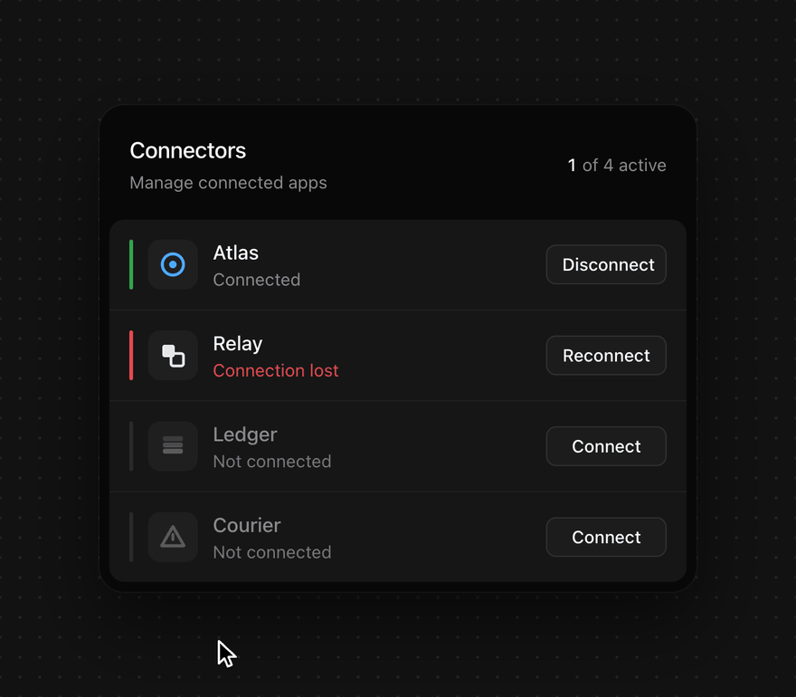

# Mikron

Measure any web page: hold Shift and drag to see padding, gaps, sizes and corner radius as a live blueprint, then copy the spec.

Mikron is a Chrome extension (Manifest V3, plain JavaScript, no build step). On any page, hold Shift and drag to draw a marquee. Inside it the page is redrawn as a blueprint: text becomes skeleton bars, paddings and gaps become hatched bands with their measured values, boxes get `W × H` chips, and rounded corners get a radius callout. Release to pin the selection, then use the **Copy** tab to copy a text (or JSON) spec of everything measured.



## Install

From the Chrome Web Store: the listing is in review. The link will be added here as soon as it is live.

For development, load the unpacked extension:

1. Open `chrome://extensions` and enable **Developer mode**.
2. Click **Load unpacked** and choose the `extension/` folder.

Requires Chrome 99 or later. On first install Mikron opens a short welcome page with a card you can measure right away.

## Usage

1. Hold the modifier (Shift by default). Nothing shows yet.
2. After 250 ms with the key held, and once the pointer has moved 4 px since then, the cursor becomes a crosshair and a hint pill (`Shift + drag`) follows it.
3. Press the primary button and drag. A press becomes a drag after 6 px of travel. The selection snaps to 4 px steps (see Settings) and its size is shown as a label.
4. Release to pin. A selection smaller than 8 px in either dimension is discarded.

While dragging, the page does not receive pointer or hover events.

### What is drawn

| Marking | Meaning |
| --- | --- |
| Blue chip, `W × H` | Border-box size of an element, in CSS px (transforms and zoom are divided out) |
| Dark chip, number | Padding or gap measured at that band, in CSS px |
| Hatched band | Padding (padding box minus content box) or the gap between an element's children |
| Graph paper | 4 px / 16 px grid over the outermost visible boxes (those with a background, shadow or border on three or more sides) |
| Dashed outline | Content box of an element that has padding |
| Grey bars | Text, one bar per line fragment; small plates for visible inline elements |
| Grey plates | Fill of visible boxes and of atoms (leaf elements such as images, icons and controls) |
| Arc + `r N` | Corner radius. Only for boxes at least 24 px on the short side, radius 2 to 64 px, and not pill-shaped on wide elements; at most 16 callouts |

Lists of five or more siblings with the same parent, label, size and padding show chips on one row at a time (the row under the selection), so the result reads as one annotated row. Spacing chips for values under 4 px are hidden when the selection is larger than about 66,000 px² (for example 256 × 256) and return below about 54,000 px².

### Pinned selection

| Action | Result |
| --- | --- |
| Click **Copy** | Copy the spec; the tab shows **Copied** |
| Cmd/Ctrl + C | Copy the spec, unless text is selected on the page or an editable field has focus |
| Esc | Dismiss (the Esc is consumed, not passed to the page) |
| Click outside the selection | Dismiss; the click reaches the page normally |
| Click inside the selection | Dismiss; the click does not reach the page, and it can start a new drag |
| Scroll the page | The selection stays attached to the content and the page is rescanned |
| Switch tab | The selection stays pinned |
| Navigate, reload, or print | Dismissed (a same-URL navigation event does not dismiss) |

## Stays out of your way

Mikron acts only on modifier + primary-button drag. It never changes anything on a plain click.

- **Typing.** Any other key pressed while the modifier is down cancels that attempt, so Shift+letter, Shift+Tab and shortcuts never arm it. Wheel scrolling while the modifier is down does the same. While an input, textarea, select or contenteditable has focus, the hold time is 500 ms and the required pointer travel is 16 px, and nothing arms within 1 s of a keystroke.
- **Ignored targets.** A press on any of these never starts a gesture, and the crosshair and hint are not shown over them: `input`, `textarea`, `select`, contenteditable elements, `[role=textbox]`, `[role=application]`, `canvas`, Monaco, Ace, CodeMirror editors, Leaflet, MapLibre, Mapbox, OpenLayers and Google Maps containers, `[draggable=true]`, `video`, `audio`, `[role=slider]`, `[role=scrollbar]`, `[role=separator]`. The check covers open shadow roots, and closed ones through the extension API. Presses on the page scrollbar are ignored.
- **Pages that claim the press.** If the page calls `preventDefault()` on `pointerdown`, or captures the pointer, the page owns the gesture and Mikron backs off.
- **Jitter.** Under 6 px of travel the press is a plain click. Mikron then replays what the browser would have done (extends the text selection, moves focus) for the mousedown default it suppressed.
- **Shift+click.** Without a drag it behaves as usual, including Shift+click to extend a text selection. The click that ends a drag is swallowed so the page does not receive it. Keyboard-triggered clicks are never swallowed.
- **Other modifiers.** Holding any modifier other than the configured one disables the gesture for that press. Touch input is ignored. Only the primary button is used.
- **Cancelling.** Esc during a drag cancels it. Losing window focus, hiding the tab, or `pagehide` cancels an in-progress gesture.
- **Per-site disable.** The popup has an **Enabled on this site** switch, which edits a list of disabled hostnames; an entry also covers its subdomains. Default list: a short set of canvas-style design and whiteboard editors (see `DEFAULTS.disabledSites` in `extension/shared/settings.js`).
- **Changing the modifier.** Choose Shift, Alt, Ctrl or Cmd in the popup. It applies immediately in open tabs. Note that on macOS, Ctrl+click is a right-click; Mikron swallows the context menu while a Ctrl gesture is in progress.
- **Cursor.** The crosshair cursor is not applied on pages with more than 5000 elements.
- **Overlay.** The UI lives in an open shadow root on a `mikron-root` element and is excluded from scans.

## Settings

Open the toolbar popup. The **How it works** link there reopens the welcome page. Settings are stored in `chrome.storage.sync` under the key `mikron` and apply live to open tabs. The badge shows `OFF` when Mikron is disabled.

| Setting | Default | Effect |
| --- | --- | --- |
| Enabled | on | Master switch for all sites |
| Enabled on this site | on, except the default disabled sites | Adds or removes the current hostname in the disabled list (http/https tabs only; hidden otherwise) |
| Hold to measure | Shift | Modifier key: Shift, Alt, Ctrl or Cmd |
| Show hint near cursor | on | The hint pill that follows the cursor when armed |
| Snap to 4px | on | Rounds selection width and height to multiples of 4 px; off rounds to whole px |
| Copy format | Text | Text or JSON spec |

| Command | Default | Effect |
| --- | --- | --- |
| `toggle-enabled` | Alt+Shift+M | Turns Mikron on or off. Rebind at `chrome://extensions/shortcuts` |

## The copied spec

Sizes are in CSS px. Runs of identical consecutive siblings collapse to one entry with `×N`. Elements cut by the selection edge are marked `(partial)`. Wrapper elements much larger than the selection are listed once on an `Inside:` line (up to four named levels). Output is capped at 200 lines. Selecting an area with nothing measurable gives `(no measurable elements)`.

Text format, from `demo/index.html` (the `page` part is the host and path of the tab):

```
Mikron — 464 × 148 selection on localhost:8000/demo/index.html
Inside: main#card.card

ul.list — 464 × 291 · radius 12 · bg rgb(22, 22, 22) (partial)
  li.row — 464 × 73 · padding 16 · gap 12 (partial)
    span.status.ok — 3 × 40 · radius 1.5 · bg rgb(48, 165, 74) (partial)
    span.icon — 40 × 40 · radius 10 · bg rgb(31, 31, 31) (partial)
    div.meta — 256 × 40 · gap 4 (partial)
      span.state "Connected" — font 14px/16px 400 (partial)
  li.row — 464 × 73 · padding 16 · gap 12
    span.status.bad — 3 × 40 · radius 1.5 · bg rgb(229, 72, 77)
    span.icon — 40 × 40 · radius 10 · bg rgb(31, 31, 31)
    div.meta — 256 × 40 · gap 4
      span.name "Relay" — font 16px/20px 500
      span.state.bad "Connection lost" — font 14px/16px 400
    button.btn "Reconnect" — 97 × 32 · padding 0 12 · radius 8 · bg rgb(28, 28, 28) · font 14px/20px 500
  li.row.off — 464 × 73 · padding 16 · gap 12 (partial)
    span.status — 3 × 40 · radius 1.5 · bg rgb(42, 42, 42)
    span.icon — 40 × 40 · radius 10 · bg rgb(31, 31, 31)
    div.meta — 256 × 40 · gap 4
      span.name "Ledger" — font 16px/20px 500
      span.state "Not connected" — font 14px/16px 400
    button.btn "Connect" — 97 × 32 · padding 0 12 · radius 8 · bg rgb(28, 28, 28) · font 14px/20px 500
```

Padding and radius use CSS shorthand order (top right bottom left). With JSON the same tree is emitted as nested objects (`label`, `size`, `padding`, `radius`, `gap`, `text`, `font`, `color`, `background`, `partial`, `children`) under `selection`, `page`, `context` and `children`.

## Permissions

Mikron asks for the least it can work with. Chrome's install dialog shows one warning, the standard all-sites one ("Read and change all your data on all websites"), because the content script runs on every page. There is no second prompt, and no `host_permissions` and no `clipboardWrite`.

| Permission | Why |
| --- | --- |
| Content script on `<all_urls>`, top frame only | The Shift + drag gesture has to work on any site without a prior click. The script stays idle until you hold the modifier and drag, then reads layout and computed styles inside your selection, locally. It is not injected into iframes. |
| `storage` | Saves your settings (on/off, disabled sites, modifier, hint, snap, copy format) in `chrome.storage.sync`. No page content is stored. |
| `activeTab` and `scripting` | Used only when you open the popup on a tab that was open before Mikron was installed: Chrome does not run a new content script there, so the popup injects Mikron's own bundled files into that one tab. Never used in the background and never on other tabs. |

Copying needs no permission: the **Copy** click and Cmd/Ctrl+C write to the clipboard from inside your own gesture, through the page's `copy` event. Nothing reads the clipboard. The only links Mikron opens are the ones you click.

## Privacy

Mikron reads page layout only while you draw or have a selection pinned, only on your device, and sends nothing anywhere: no network requests, no analytics, no remote code. Settings live in Chrome's own storage and sync through your Chrome account if you use Sync. See [PRIVACY.md](PRIVACY.md).

## Limitations

- **Top frame only.** The content script does not run in iframes, so their contents are not measured; an iframe is drawn as a single box. The overlay is never injected into a frame.
- **Cross-origin iframes** cannot be measured, for the same reason.
- **Canvas, video, and similar replaced content** is one box with a size; what is painted inside is not inspected. A press on `canvas` or `video` does not start a gesture.
- **Shadow DOM.** Open shadow roots are scanned. Closed roots are scanned only for custom elements (names with a hyphen), and only through `chrome.dom.openOrClosedShadowRoot`.
- **Scan budget.** A scan covers the viewport plus a 300 px margin, stops at 1500 nodes or 40 ms, and then returns what it has. When that happens the size label reads `W × H · partial` and the copied spec starts with a note (`"truncated": true` in JSON): on very large pages part of the selection is missing from both the drawing and the spec. Pinned selections rescan on scroll and resize.
- **Caps.** At most 500 chips are live at once, 16 radius callouts, 200 spec lines.
- **Transforms.** Rotated or skewed elements get no padding bands, spacing chips or radius callouts. Scaled and zoomed elements are measured in their own CSS px.
- **Pointer input only.** No touch gesture and no keyboard-only way to draw a selection.
- **Pages Chrome does not let extensions run on** (`chrome://` pages, the Chrome Web Store, other extensions' pages) have no content script. The popup says so (`Mikron can't run on this page`). `file://` pages need **Allow access to file URLs** in `chrome://extensions`.
- **Tabs open before the install** have no content script until reloaded. Clicking the Mikron icon on such a tab starts it there without a reload.
- Mikron suppresses page hover events while dragging, so hover-only UI does not react during a drag.

## Development

No build step; load `extension/` directly.

```
extension/
  manifest.json          MV3 manifest; content script order; toggle command
  background.js          service worker: welcome page on first install, OFF badge, toggle command, serves the font bytes
  shared/settings.js     MikronSettings: defaults, load/save/subscribe, disabled-site matching
  shared/links.js        MikronLinks: the repository, issues and Ko-fi URLs (one definition)
  content/tokens.js      colours, timings, font stacks
  content/font.js        registers the bundled chip font (FontFace from bytes sent by the service worker)
  content/scan.js        DOM scanner -> model of boxes, atoms, padding, gaps, radii, text
  content/spec.js        formats the model as the text / JSON spec
  content/blueprint.js   canvas drawing, chips, radius callouts
  content/ui.js          overlay host: hint pill, marquee, size label, Copy tab
  content/main.js        gesture state machine, scan scheduling, copy, teardown
  welcome/               first-run page (html, css, js); loads the content scripts itself so its card is measurable
  fonts/                 GeistMono-Bold.woff2 (latin subset, 10 KB) and OFL.txt, its licence
  popup/                 settings popup (html, css, js); injects the content script into a tab that lacks it
  icons/                 16/32/48/128 PNG
demo/index.html          dark "Connectors" card with fictional products
demo/light.html          light, content-rich page
tests/                   Playwright suite (run.mjs, cases/, fixtures/, lib/)
tools/make-icons.mjs     regenerates the icons
tools/package.mjs        builds dist/mikron-<version>.zip for the Chrome Web Store
tools/record-demo.mjs    records mikron-demo.mp4 from the real extension
```

Chips, the size label and the illustration in the popup use a bundled copy of Geist Mono Bold (latin subset, 10 KB, SIL Open Font License 1.1, text in `extension/fonts/OFL.txt`), registered under the private family name `Mikron Mono`. The content script obtains the bytes from the service worker and adds them with `new FontFace(...)` on first use, so it works under any page CSP and needs no `web_accessible_resources`; if loading fails the system monospace stack is used.

Install dependencies once (Playwright and its Chromium):

```bash
npm install
```

```bash
npx playwright install chromium
```

Run the tests. The suite (303 cases, about four minutes) launches Chromium with the unpacked extension (headless, persistent context) and serves fixtures from `tests/fixtures/` and the demo pages over a local HTTP server. Each fresh browser profile opens the welcome tab; the harness closes it so the page under test stays in front. Pass a name filter as an argument to run a subset:

```bash
npm test
```

```bash
node tests/run.mjs welcome
```

Headless Chromium cannot click the toolbar icon, and `chrome.action.openPopup()` does not grant `activeTab`, so the popup-injection tests run against a throwaway copy of the extension that adds `host_permissions` in its manifest (see `tests/lib/variants.mjs`).

Build the Chrome Web Store package (writes `dist/mikron-<version>.zip`; refuses a manifest with a `key`, a missing file, or a description over 132 characters):

```bash
npm run package
```

Regenerate the icons (writes `extension/icons/`):

```bash
node tools/make-icons.mjs
```

Re-record the demo video (about a minute; needs ffmpeg with libx264 and python3 with Pillow; writes `mikron-demo.mp4`, which is git-ignored):

```bash
node tools/record-demo.mjs
```

Content scripts do not run on `file://` pages by default, so serve the repo to try the demo pages:

```bash
python3 -m http.server 8000
```

Then open `http://localhost:8000/demo/index.html` (dark card, 480 px wide) or `http://localhost:8000/demo/light.html`.

## Licence

Apache License 2.0, see [LICENSE](LICENSE). The bundled Geist Mono font is under the SIL Open Font License 1.1; see [NOTICE](NOTICE) and `extension/fonts/OFL.txt`.

## Say thanks

Mikron is free. If it saved you some time, you can say thanks on Ko-fi: <https://ko-fi.com/dabarov>. It is entirely optional, and nothing in the extension asks for it beyond a quiet link in the popup.
